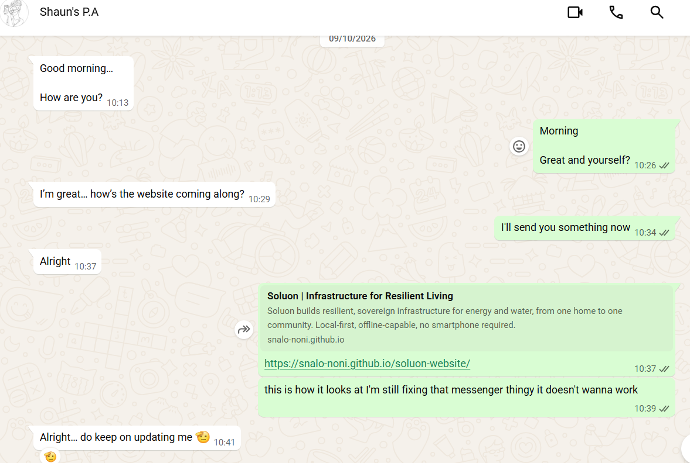

# Agile Team Charter Evidence

[← Back to portfolio](../README.md)

An Agile team charter is a living, co-created social contract that defines a team's shared purpose, core values, working agreements and operational boundaries, to reduce friction and align daily execution. This page presents the charter for the **Soluon Website** project and the evidence that the team worked to it.

## 1. Project and Purpose

**Project:** Soluon Website – a single-page company website for Soluon.

**Shared purpose:** Give Soluon a public website that clearly explains what the company builds, who it serves and how to get in touch.

## 2. Team Members and Roles

| Name | Role | Responsibilities |
|---|---|---|
| Snalo Noni | Sole designer and developer | Designed, built, tested and updated the website. See the [logbook](../05-agile-logbook/evidence.md) for the dated commits. |
| Agreement Lethube | Personal Assistant to Shaun | Supplied the information the team wanted on the website, and received my progress updates. |
| Shaun | Product Owner | Owned the vision for the website. Approval of the demo and deployment waited for him (see the [sprint backlog](../04-sprint-backlog/evidence.md)). |

The stand-up of 2 October 2026 recorded the actions that fixed these roles, including "Snalo will develop the website" and that Agreement would send the information needed for the site. See the [sprint kick-off evidence](../04-sprint-backlog/evidence.md#sprint-kick-off-evidence).

## 3. Core Values

| Value | What it looks like in practice |
|---|---|
| Communication | I gave Agreement and the team updates at the Monday, Wednesday and Friday stand-ups and on WhatsApp. |
| Accountability | I took ownership of building the whole website, and told the team when something (the contact form) was not working. |
| Continuous improvement | I kept improving the site: I updated the contact form, rebuilt pages and updated the team section. |

## 4. Working Agreements

| Area | Agreement |
|---|---|
| Communication channel | A WhatsApp group for updates and communication, and direct WhatsApp messages with Agreement Lethube (see Figure 1). |
| Meetings | Stand-ups on Monday, Wednesday and Friday for updates and communication, held on Google Meet. |
| Workflow | During the sprint, work was tracked through the stand-ups and WhatsApp. A Trello board was reconstructed afterwards from the GitHub commit history (see the [user stories evidence](../02-user-stories-and-tasks/evidence.md#8-trello-board)). |
| Version control | All work was committed to GitHub. See the commit history in the [logbook evidence](../05-agile-logbook/evidence.md). |
| Decision making | The Product Owner was shown the work at the demo. When he was unavailable on the day of the demo, deployment waited until the following Monday. |

## 5. Definition of Done

A task is done when:

- the change is coded and checked in the browser,
- the change is checked on a phone screen,
- the change is committed to GitHub, and
- the work has been shown to the team or Product Owner at a stand-up or the demo.

## 6. Operational Boundaries

- **Availability:** Stand-ups on Monday, Wednesday and Friday. Time outside the stand-ups was limited by school projects and a hackathon we attended to represent Soluon.
- **Conflict resolution:** Issues were raised at the stand-ups, and Shaun decided as Product Owner.

## 7. Supporting Evidence

### 7.1 Progress Update to Agreement Lethube

  

<strong>Figure 1.</strong> WhatsApp conversation of 9 October 2026 in which Agreement Lethube, Shaun's personal assistant, asks how the website is coming along and I send the link to the work-in-progress site. Select the image to view it at full size.

**Evidence shown:** The messages record a progress check from Agreement Lethube, a link to the working website, and my note that one feature (the messenger) was still being fixed. She asks me to keep updating her.

## 8. Evidence Alignment

No written charter document existed at the start of the sprint. The agreements on this page were set at the 2 October 2026 stand-up and in how the team worked, and I have written them down in this portfolio afterwards. The evidence below shows that the team kept to them.

| Agreement | Evidence it was followed |
|---|---|
| Stand-ups on Monday, Wednesday and Friday | The Read AI action items from the 2 October stand-up ([sprint kick-off evidence](../04-sprint-backlog/evidence.md#sprint-kick-off-evidence)) and the recap of the 26 October stand-up ([stand-up recap evidence](../05-agile-logbook/evidence.md#3-stand-up-recap-evidence)) |
| Updates and communication on WhatsApp | The conversation of 9 October 2026 with Agreement Lethube (Figure 1 above) |
| All work committed to GitHub | The dated commit history for 9 to 16 October 2026 ([development log](../05-agile-logbook/evidence.md#2-development-log-from-github)) |
| The Product Owner sees the work at the demo | The demo on 16 October, with deployment waiting until the Product Owner was available ([sprint outcome](../04-sprint-backlog/evidence.md#sprint-outcome)) |
