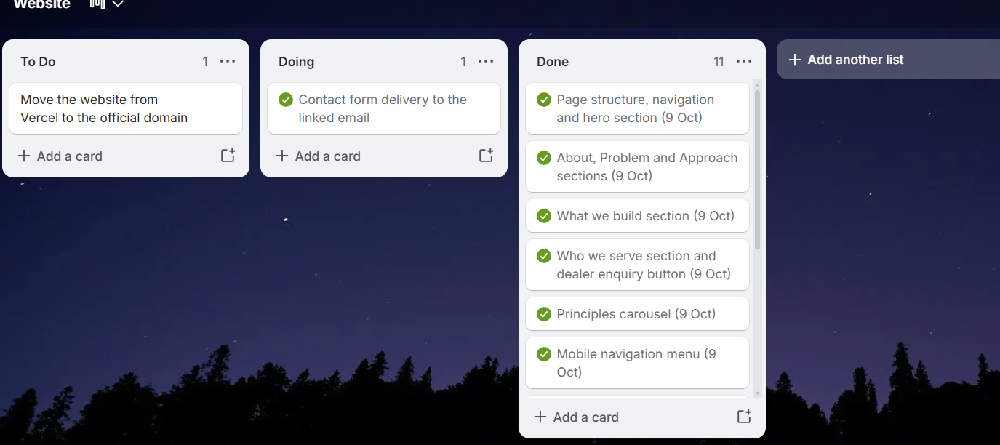

# User Stories and Tasks Evidence

[← Back to portfolio](../README.md)

A user story is a short description of a feature written from the end-user's perspective, and each story is broken into tasks. This page presents the user stories for the **Soluon Website**, their task breakdown and the evidence of the work.

> **TODO (delete this note):** The stories below were drafted from the sections that exist on the finished website. Keep, reword or delete each one so the page shows what your team actually wrote. If a story was written after the work was done, say so honestly in your reflection.

**Project board:** TODO – paste your public Trello board link

## 1. Understanding Soluon

### 1.1 User Story

> **As a first-time visitor, I want to understand what Soluon does as soon as the page opens so that I can decide whether to keep reading.**

### 1.2 Task Breakdown

- Build the page structure, navigation and hero section.
- Write the "What Soluon is about" section.

### 1.3 Evidence

- Commit: [Add Soluon company website (00fc9d5)](https://github.com/snalo-noni/soluon-website-/commit/00fc9d5)
- Trello card: TODO
- Screenshot: TODO (save in `assets/user-stories/`)

## 2. The Problem and the Approach

### 2.1 User Story

> **As a potential partner or NGO, I want to read about the problem Soluon addresses and its approach so that I can judge whether it fits our goals.**

### 2.2 Task Breakdown

- Write "The problem" section.
- Write the "Calm, local and built to last" approach section.
- Build the principles carousel.

### 2.3 Evidence

- Commit: [Add Soluon company website (00fc9d5)](https://github.com/snalo-noni/soluon-website-/commit/00fc9d5)
- Trello card: TODO
- Screenshot: TODO

## 3. What Soluon Builds

### 3.1 User Story

> **As a household or community leader, I want to see what Soluon builds so that I know which product fits my need.**

### 3.2 Task Breakdown

- Write the "What we build" section.
- Add a call to action to ask about the app.

### 3.3 Evidence

- Commit: [Add Soluon company website (00fc9d5)](https://github.com/snalo-noni/soluon-website-/commit/00fc9d5)
- Trello card: TODO
- Screenshot: TODO

## 4. Who Soluon Serves

### 4.1 User Story

> **As a rural dealer, I want to see who Soluon serves and how to become a dealer so that I can make an enquiry.**

### 4.2 Task Breakdown

- Write the "Who we serve and who we work with" section.
- Add the "Become a dealer" button linking to the contact section.
- Add the dealer enquiry email contact.

### 4.3 Evidence

- Commit: [Add Soluon company website (00fc9d5)](https://github.com/snalo-noni/soluon-website-/commit/00fc9d5)
- Trello card: TODO
- Screenshot: TODO

## 5. Meeting the Team

### 5.1 User Story

> **As a visitor, I want to meet the team so that I trust the people behind Soluon.**

### 5.2 Task Breakdown

- Build the "The people building Soluon" section.
- Add team photos and profiles.
- Update Emmanuel's profile and photo.
- Add Agreement Lethube to the team section.

### 5.3 Evidence

- Commits: [Update Emmanuel profile and form email (f5d0119)](https://github.com/snalo-noni/soluon-website-/commit/f5d0119), [Point to new Emmanuel photo (7da3965)](https://github.com/snalo-noni/soluon-website-/commit/7da3965), [Add Agreement Lethube to team section (ac126f3)](https://github.com/snalo-noni/soluon-website-/commit/ac126f3)
- Trello card: TODO
- Screenshot: TODO

## 6. Sending an Enquiry

### 6.1 User Story

> **As a visitor, I want to send an enquiry through a contact form so that my message reaches the right Soluon contact.**

### 6.2 Task Breakdown

- Build the contact section and enquiry form.
- Send the form to a test inbox.
- Update the contact form.
- Update the form email address.

### 6.3 Evidence

- Commits: [Send contact form to test inbox (9b8a5bf)](https://github.com/snalo-noni/soluon-website-/commit/9b8a5bf), [Update contact form (ce78e93)](https://github.com/snalo-noni/soluon-website-/commit/ce78e93), [Update Emmanuel profile and form email (f5d0119)](https://github.com/snalo-noni/soluon-website-/commit/f5d0119)
- Trello card: TODO
- Screenshot: TODO

## 7. Using the Site on a Phone

### 7.1 User Story

> **As a mobile visitor, I want a working navigation menu on my phone so that I can reach every section on a small screen.**

### 7.2 Task Breakdown

- Add the menu button for small screens.
- Test the navigation on a phone.

### 7.3 Evidence

- Commit: [Add Soluon company website (00fc9d5)](https://github.com/snalo-noni/soluon-website-/commit/00fc9d5)
- Trello card: TODO
- Screenshot: TODO – for example the site on a phone

## 8. Trello Evidence

> **TODO (delete this note):** Add screenshots of your Trello board showing the stories as cards with their tasks. Save them in `assets/user-stories/`. Show dates and your name where possible.

```markdown
<p align="left">
  <a href="../assets/user-stories/trello-board.png"></a>
</p>

<p align="left"><sub><strong>Figure 1.</strong> What the screenshot shows and its date.</sub></p>
```
