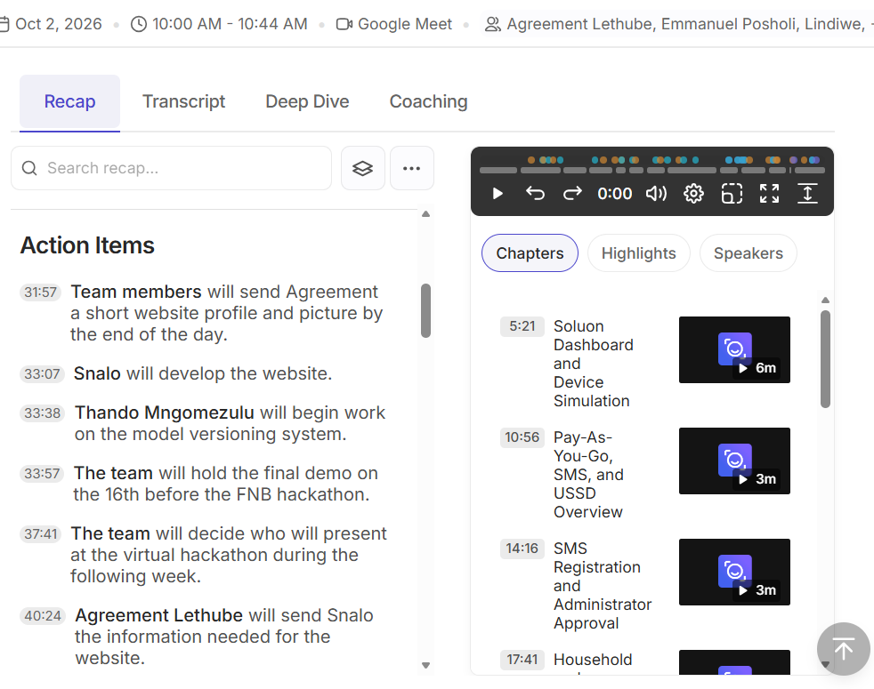

# Sprint Backlog Evidence

[← Back to portfolio](../README.md)

A sprint backlog is a real-time, actionable plan created by and for the developers that outlines the specific work needed to achieve the sprint goal. This page records the sprint for the **Soluon Website**.

## Sprint 1: Soluon Company Website

| Item | Detail |
|---|---|
| Sprint dates | 9 October 2026 to 16 October 2026 |
| Sprint goal | Publish the Soluon company website with all core sections, a working contact form and the team section. |
| Team capacity | One developer (me). The website took about three days. |

### Sprint Backlog Items

| Backlog item | Task | Owner | Status | Done on | Evidence |
|---|---|---|---|---|---|
| PB-01, PB-02, PB-03, PB-05, PB-07 | Build the initial site: structure, navigation, content sections and principles carousel | Snalo Noni | Done | 9 Oct | [00fc9d5](https://github.com/snalo-noni/soluon-website-/commit/00fc9d5) |
| PB-04 | Send the contact form to a test inbox | Snalo Noni | Done | 9 Oct | [9b8a5bf](https://github.com/snalo-noni/soluon-website-/commit/9b8a5bf) |
| PB-04 | Update the contact form | Snalo Noni | Done | 12 Oct | [ce78e93](https://github.com/snalo-noni/soluon-website-/commit/ce78e93) |
| PB-08 | Rebuild the pages and restore the site page with the updated form | Snalo Noni | Done | 12 Oct | [9a3c8d1](https://github.com/snalo-noni/soluon-website-/commit/9a3c8d1), [abe64fa](https://github.com/snalo-noni/soluon-website-/commit/abe64fa) |
| PB-06, PB-09 | Update Emmanuel's profile and photo, and update the form email | Snalo Noni | Done | 16 Oct | [f5d0119](https://github.com/snalo-noni/soluon-website-/commit/f5d0119), [7da3965](https://github.com/snalo-noni/soluon-website-/commit/7da3965) |
| PB-06, PB-09 | Add Agreement Lethube to the team section | Snalo Noni | Done | 16 Oct | [ac126f3](https://github.com/snalo-noni/soluon-website-/commit/ac126f3) |
| PB-04 | Try form services (Vercel, FormSubmit and others) to send visitors' messages to the linked email | Snalo Noni | Not working reliably | – | – |
| PB-10 | Deploy the website after the demo | Snalo Noni | Planned for Monday 19 Oct | – | – |

### Sprint Kick-off Evidence

  

<strong>Figure 1.</strong> Read AI action items from the virtual stand-up held on Google Meet on 2 October 2026, 10:00 to 10:44. Select the image to view it at full size.

**Evidence shown:** The action items record that I would develop the website, that team members would send Agreement a short website profile and picture, and that Agreement would send me the information needed for the website. This is the dated record of how the website work was assigned before the first commit on 9 October 2026.

### Sprint Outcome

- **Planned items:** The website, ready for the demo on 16 October.
- **Completed:** The website was built in about three days and shown at the demo on 16 October. The other members loved it.
- **Carried over:** Deployment, which was set for the following Monday (19 October) because the Product Owner was unavailable on the day of the demo, and reliable delivery of contact-form messages to the linked email.

### Sprint Retrospective

| Went well | Did not go well | Action for the next sprint |
|---|---|---|
| Everything went well on my side. The other members loved the demo. | The company did not own a domain, so I had to wait before deploying. The contact form did not send messages to the linked email reliably. I was also busy with a hackathon and school projects. | Leave more buffer time for the contact form and deployment. |
