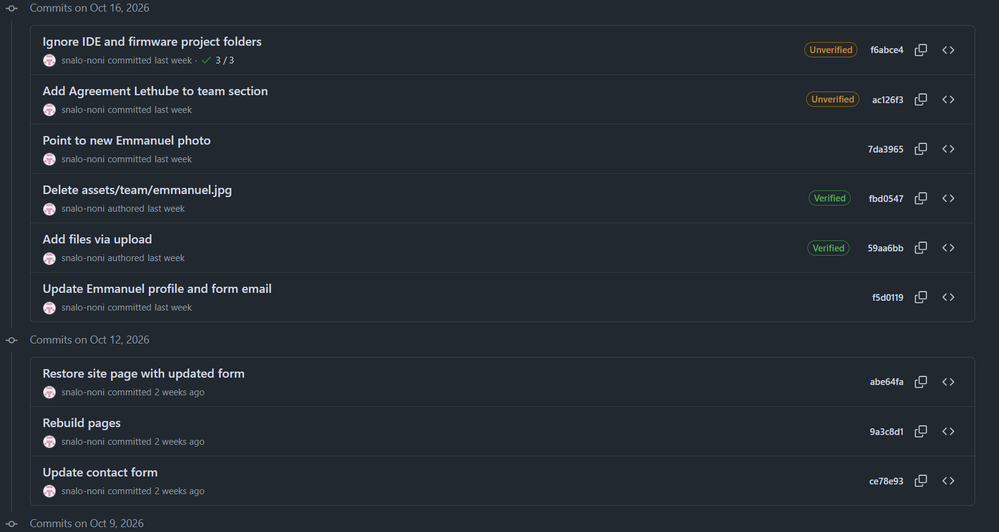
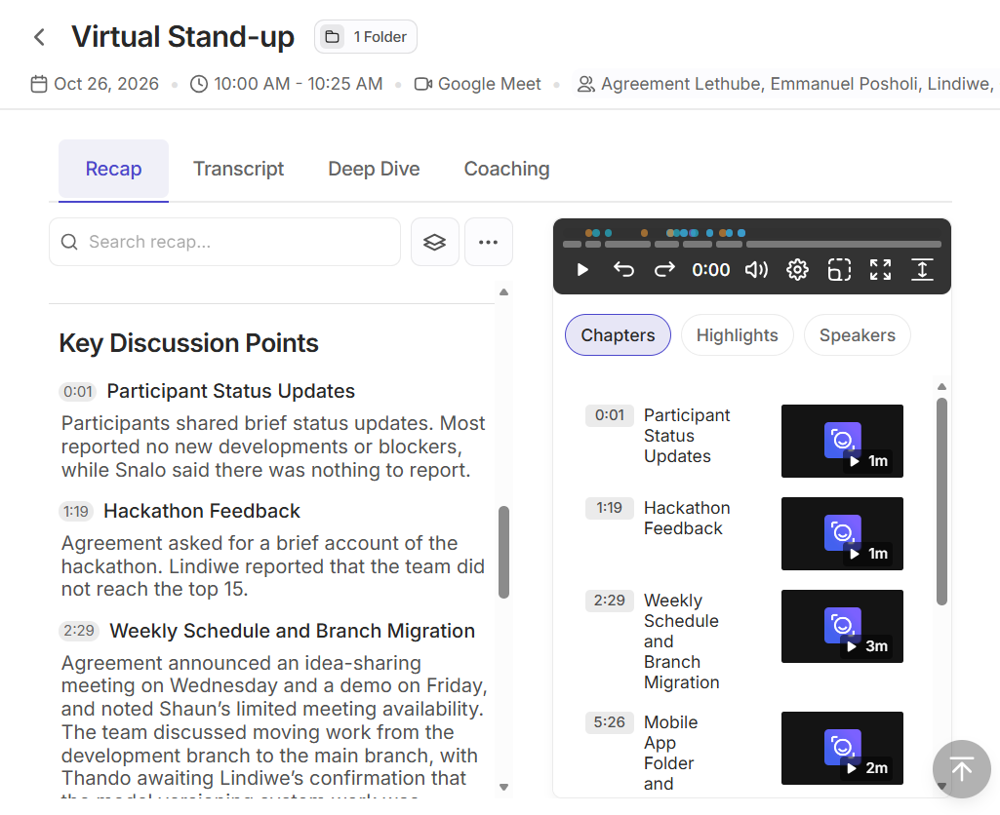
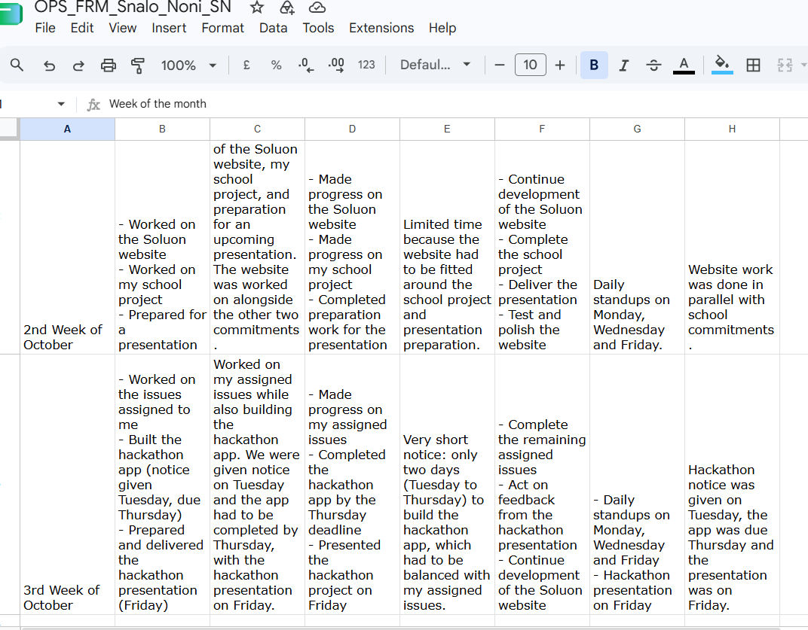

# Agile Logbook Evidence

[← Back to portfolio](../README.md)

An agile logbook records daily stand-ups, sprint plans and retrospective notes as the project happens. This page presents the logbook for the **Soluon Website**.

## 1. Logbook Entries

- [Logbook: 9 – 16 October 2026](../assets/logbooks/logbook-9-16-october-2026.md) – taskboard, walkthrough, daily stand-ups and retrospective

## 2. Development Log from GitHub

Repository: [snalo-noni/soluon-website-](https://github.com/snalo-noni/soluon-website-)

  

<strong>Figure 1.</strong> Commit history of the Soluon website repository on GitHub for 12 and 16 October 2026. Select the image to view it at full size.

| Date | Commit | What was done |
|---|---|---|
| 9 Oct 2026 | [00fc9d5](https://github.com/snalo-noni/soluon-website-/commit/00fc9d5) | Add Soluon company website |
| 9 Oct 2026 | [4d902be](https://github.com/snalo-noni/soluon-website-/commit/4d902be) | Remove IDE folder |
| 9 Oct 2026 | [9b8a5bf](https://github.com/snalo-noni/soluon-website-/commit/9b8a5bf) | Send contact form to test inbox |
| 9 Oct 2026 | [662de83](https://github.com/snalo-noni/soluon-website-/commit/662de83), [ef36fbf](https://github.com/snalo-noni/soluon-website-/commit/ef36fbf) | Create CNAME, then delete CNAME |
| 12 Oct 2026 | [ce78e93](https://github.com/snalo-noni/soluon-website-/commit/ce78e93) | Update contact form |
| 12 Oct 2026 | [9a3c8d1](https://github.com/snalo-noni/soluon-website-/commit/9a3c8d1) | Rebuild pages |
| 12 Oct 2026 | [abe64fa](https://github.com/snalo-noni/soluon-website-/commit/abe64fa) | Restore site page with updated form |
| 16 Oct 2026 | [f5d0119](https://github.com/snalo-noni/soluon-website-/commit/f5d0119) | Update Emmanuel profile and form email |
| 16 Oct 2026 | [59aa6bb](https://github.com/snalo-noni/soluon-website-/commit/59aa6bb), [fbd0547](https://github.com/snalo-noni/soluon-website-/commit/fbd0547), [7da3965](https://github.com/snalo-noni/soluon-website-/commit/7da3965) | Upload new team photo, delete the old photo, point the page to the new photo |
| 16 Oct 2026 | [ac126f3](https://github.com/snalo-noni/soluon-website-/commit/ac126f3) | Add Agreement Lethube to team section |
| 16 Oct 2026 | [f6abce4](https://github.com/snalo-noni/soluon-website-/commit/f6abce4) | Ignore IDE and firmware project folders |

**Evidence shown:** The commit history is a dated, independent record of the development work from 9 to 16 October 2026.

## 3. Stand-up Recap Evidence

The team held stand-ups on Monday, Wednesday and Friday for updates and communication.

  

<strong>Figure 2.</strong> Read AI recap of the virtual stand-up held on Google Meet on 26 October 2026, 10:00 to 10:25. Select the image to view it at full size.

**Evidence shown:** The recap lists the participants' status updates and the other points discussed, including hackathon feedback and the weekly schedule and branch migration. It is a dated record that the team met for a stand-up after the 9 to 16 October sprint.

## 4. Weekly Record

  

<strong>Figure 3.</strong> My weekly record (OPS_FRM_Snalo_Noni_SN) for the 2nd and 3rd weeks of October 2026. Select the image to view it at full size.

**Evidence shown:** For the 2nd week of October, the record shows work on the Soluon website alongside my school project and a presentation, with limited time because the website had to be fitted around those commitments. For the 3rd week, it shows work on my assigned issues and a hackathon app (notice given on Tuesday, due on Thursday, presented on Friday), the plan to continue developing the website, and stand-ups on Monday, Wednesday and Friday.
