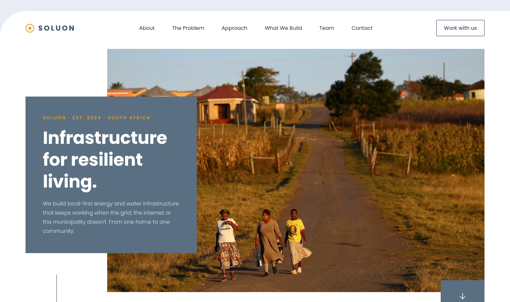

# Agile GitHub Portfolio

## Soluon Website

A portfolio of Agile evidence and reflections for **Project Presentation 3 (PRP370S)**.

## Student Details

- **Name and Surname:** Snalo Noni
- **Student Number:** 230541844
- **Institution:** Cape Peninsula University of Technology
- **Course:** Diploma in Information and Communication Technology <!-- TODO: confirm the exact qualification name on your registration -->
- **Module:** Project Presentation 3
- **Module Code:** PRP370S / PRP371S / PRP372S

## Project Overview

This portfolio documents the development of the **Soluon Website** between 9 and 16 October 2026. The project involved building a public company website, organising the work into backlog items and a sprint, and recording progress in an Agile logbook.

Soluon is a South African infrastructure-technology company, founded in 2024, that builds resilient energy and water systems on a common platform called NODE. Its tagline is "Infrastructure for Resilient Living – from one home to one community" (Soluon, 2026).

The Soluon Website is a single-page company website. It presents the company's mission, the problem it addresses, its approach, what it builds, who it serves, its principles and its team, and it gives visitors a contact form for general, partnership and rural-dealer enquiries.

<!-- TODO (delete this note): add one sentence on your own role in the project, for example "I was the developer responsible for ...", and anything else you can truthfully claim. -->

  

Soluon website homepage. Select the image to view it at full size.

## Technology Stack

### Website Development

-  **HTML** — Structures the single-page website and its sections.
-  **CSS** — Styles the layout and makes the site responsive on phones and larger screens.
-  **JavaScript** — Powers the mobile menu, the principles carousel and the page interactions.

### Version Control

-  **GitHub** — Stores the source code and records the dated project history.

<!-- TODO (delete this note): add anything else you actually used, for example Trello, Figma, a form service or hosting. -->

Technology logos sourced from [Devicon](https://devicon.dev/).

## Project Links

- **Source Code:** [Soluon Website on GitHub](https://github.com/snalo-noni/soluon-website-) <!-- TODO: confirm this is the repository your commit links point to; the evidence pages currently use github.com/shaun549/soluon-website- -->
- **Live Website:** TODO – paste the live Soluon website link, or delete this line if there is none
- **Project Board:** TODO – paste your public Trello board link

## Portfolio Sections

###  1. Agile Team Charter

- [View Evidence](01-agile-team-charter/evidence.md)
- [Reflection](01-agile-team-charter/reflection.md)

###  2. User Stories and Tasks

- [View Evidence](02-user-stories-and-tasks/evidence.md)
- [Reflection](02-user-stories-and-tasks/reflection.md)

###  3. Product Backlog

- [View Evidence](03-product-backlog/evidence.md)
- [Reflection](03-product-backlog/reflection.md)

###  4. Sprint Backlog

- [View Evidence](04-sprint-backlog/evidence.md)
- [Reflection](04-sprint-backlog/reflection.md)

###  5. Agile Logbook

- [View Evidence](05-agile-logbook/evidence.md)
- [Reflection](05-agile-logbook/reflection.md)

## Connect: How the Sections Fit Together

<!-- TODO (delete this note): write one short paragraph in your own words. Say how the charter shaped the way you worked, how the user stories became backlog items, how the sprint backlog drove the logbook entries, and what the whole process taught you. -->

TODO

## References

Soluon (2026) *SOLUON – Company Profile, Version 1.8*. Internal company document, June 2026.
